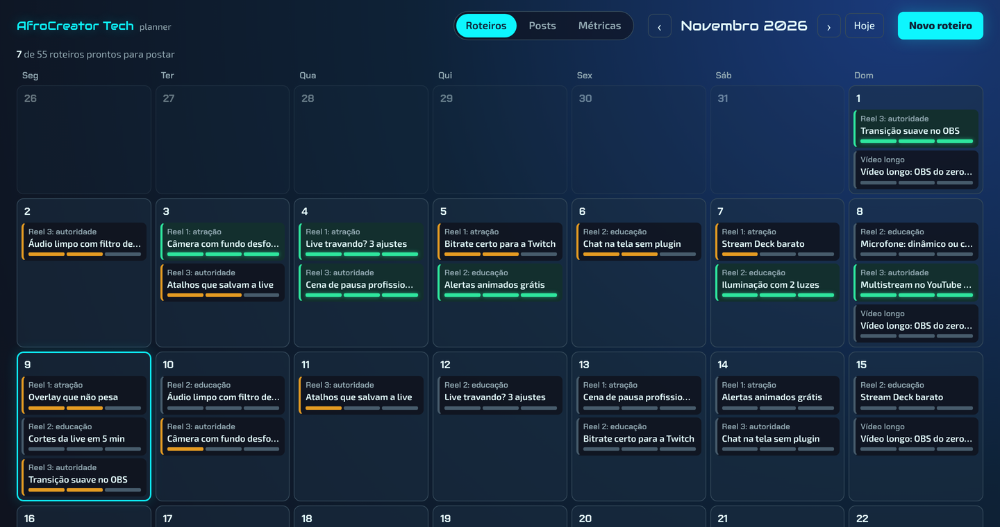
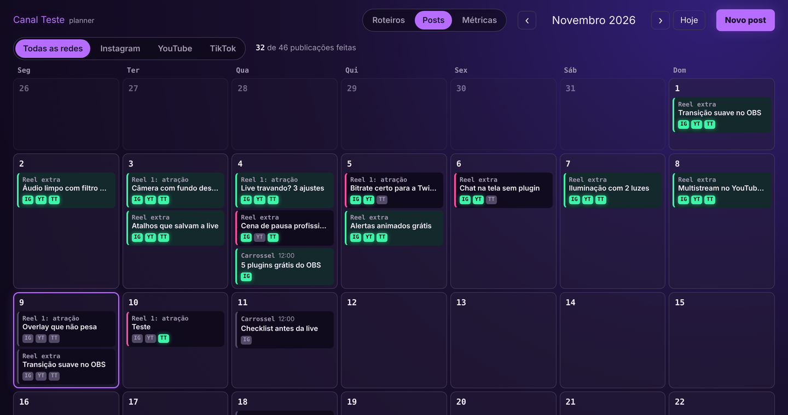

<div align="center">

# AfroCreator Planner

**Organize roteiros, acompanhe o que já foi postado em cada rede e veja seus seguidores crescerem.**
Um app que roda no seu computador, sem mensalidade e sem cadastro.




</div>

## Para quem é

Para criador de conteúdo que **posta à mão** em várias redes e se perde entre "já gravei?", "já editei?" e "já postei no TikTok?".
O Planner não publica nada por você: ele organiza a produção e marca onde cada vídeo já saiu.

## O que ele faz

| | |
|---|---|
| 📝 **Calendário de roteiros** | Escreva o roteiro e marque as etapas (ex.: gravação, edição). Quando todas ficam prontas, o card fica verde e o post é criado sozinho. |
| 📅 **Calendário de posts** | Um check por rede em cada post. Filtre por rede para ver o que falta no Instagram, YouTube, TikTok... |
| 🎬 **Prévia do Google Drive** | O vídeo continua no seu Drive; o Planner guarda só o link e mostra a prévia. |
| 📈 **Métricas** | Crescimento de seguidores em 30, 60, 90 dias até 1 ano, com meta e ritmo necessário por dia. Coleta automática no Instagram e no YouTube. |
| 🤖 **Agentes de IA** *(opcional)* | Ligado ao [kit de agentes](https://github.com/leamedsil/afrocreator-agentes), recebe o que você aprovou no Discord e pede as legendas aos agentes. |
| 📱 **Celular** | No celular vira uma agenda em lista. Arraste e solte para mudar a data no computador. |

## Personalizado para você

Na instalação, o Planner faz algumas perguntas e se monta do seu jeito:

- **Marca:** nome e texto que aparecem no topo.
- **Visual:** 4 temas prontos (AfroCreator Tech, Roxo neon, Verde gamer, Vermelho live) ou as **cores da sua marca**, com fontes tech ou do sistema.
- **Redes:** Instagram, Facebook, YouTube, TikTok, Kwai. Só aparecem as que você usa.
- **Tipos de conteúdo:** vídeos curtos, vídeos longos, carrosséis e animações.
- **Etapas de produção:** de 1 a 3, com os nomes que você quiser (ex.: "Roteiro pronto", "Gravado", "Editado").
- **Vídeos curtos por dia:** até 3 "faixas" com função própria (ex.: atração, educação, autoridade).
- **Métricas:** quais redes, se quer uma meta e até quando.
- **Acesso:** só no seu computador, ou também no celular pela rede de casa.
- **Tela inicial:** roteiros, posts ou métricas.

<div align="center">



*O mesmo Planner com o tema Roxo neon, só 3 redes e 2 etapas de produção.*

</div>

## Instalação

### 🐧 Linux (recomendado)

Funciona melhor no Linux: o Planner vira um serviço que liga sozinho com o computador e fica leve rodando em segundo plano. Testado no Ubuntu 22.04 e 24.04.

```bash
git clone https://github.com/leamedsil/afrocreator-planner.git
cd afrocreator-planner
./instalar.sh
```

Responda as perguntas e abra **http://127.0.0.1:8765** no navegador.

> Não tem o `git`? `sudo apt install git python3` e rode de novo.

### 🪟 Windows 10 e 11

1. Clique em **Code → Download ZIP** aqui em cima e extraia a pasta (por exemplo, em `Documentos`).
2. Dê **dois cliques em `instalar-windows.bat`**.
3. Se o Windows mostrar "O Windows protegeu o computador", clique em **Mais informações → Executar assim mesmo**.
4. Se você não tiver Python, o instalador oferece instalar pelo `winget`.
5. Responda as perguntas. O navegador abre sozinho no fim.

O Planner passa a iniciar sozinho quando você entra no Windows (tarefa agendada, sem precisar de administrador).

### Mudar as respostas depois

| | Linux | Windows |
|---|---|---|
| Refazer as perguntas | `./instalar.sh --reconfigurar` | `instalar-windows.bat` → opção 2 |
| Instalar sem perguntas | `./instalar.sh --padrao` | `instalar.ps1 -Padrao` |
| Desinstalar (mantém os dados) | `./instalar.sh --desinstalar` | `instalar-windows.bat` → opção 3 |

Também dá para editar o `config.json` direto. O [`config.exemplo.json`](config.exemplo.json) mostra todas as opções.

## Métricas automáticas (opcional)

- **Instagram:** precisa de uma conta profissional e de um token da API do Instagram.
- **YouTube:** precisa de uma chave de API do Google Cloud (YouTube Data API v3, gratuita).
- **TikTok:** a API exige aprovação do app, então você lança o número à mão na aba Métricas (1 vez por semana basta).

```bash
python3 coletar_metricas.py configurar      # no Windows: py -3 coletar_metricas.py configurar
```

As chaves ficam só em `data/credenciais.json`, no seu computador. A coleta roda todo dia às 9h10.

## Seus dados

- Tudo fica em `data/planner.db` (SQLite), no seu computador. Nada vai para a internet.
- Backup automático a cada 6 horas em `data/backups/`, guardando os últimos 14 dias.
- A pasta `data/` e o `config.json` estão no `.gitignore`: nunca sobem para o GitHub.

## Segurança

O Planner **não tem senha**. Por isso, por padrão ele só abre no próprio computador.
Se você liberar para a rede de casa, use só em rede de confiança, **nunca em Wi-Fi público**, e não abra a porta no roteador.

## Como funciona por dentro

- `server.py`: servidor e API, usando só a biblioteca padrão do Python (nada para instalar com pip).
- `static/`: a página (HTML, CSS e JavaScript puro).
- `configuracao.py` e `configurar.py`: as opções e as perguntas do instalador.
- `coletar_metricas.py`: a coleta diária de seguidores.
- `sincronizar.py`: a integração com os agentes de IA.

## Feito por

**Leandro Freitas (Leamed)** · [AfroCreator Tech](https://github.com/leamedsil): tecnologia para criadores de conteúdo e streamers.
Se te ajudou, deixa uma ⭐ e me conta nos comentários do canal.

Licença [MIT](LICENSE). As fontes estão sob a SIL Open Font License ([detalhes](static/fonts/LEIA-ME.md)).
